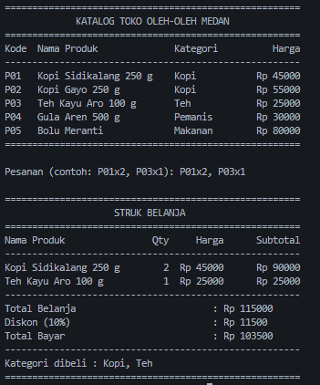
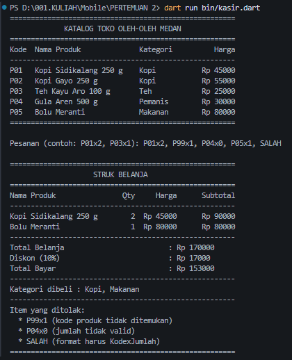

# Tugas Rutin 2 - Aplikasi Console Kasir Sederhana
---

## (a) Identitas Mahasiswa

- **Nama**: M. Gali Almahdi
- **NIM**: 4243250042
- **Kelas / Prodi**: Ilmu Komputer 24 D
- **Mata Kuliah**: Pemrograman Mobile

---

## (b) Tangkapan Layar & Hasil Pengujian Skenario

### Skenario 1: Pesanan Valid (Mencapai Diskon 10%)
Input: `P01x2, P03x1`

---

### Skenario 2: Pesanan yang Mengandung Kode Salah & Jumlah Tidak Valid
Input: `P01x2, P99x1, P04x0, P05x1, SALAH`

---

## (c) Penjelasan `var`, `final`, `const`, dan Penerapan Null Safety

### 1. Perbedaan `var`, `final`, dan `const`
Dalam bahasa Dart:
- **`var`**: Mendeklarasikan variabel dengan tipe yang disimpulkan otomatis oleh compiler type inference, dan nilainya dapat diubah mutable selama program berjalan.
- **`final`**: Variabel yang hanya dapat diinisialisasi satu kali saat runtime (saat program dieksekusi). Nilainya tidak dapat diubah kembali setelah ditetapkan. Pada program kasir ini, sebagian besar variabel seperti katalog (baris 5), daftarPesanan (baris 45), dan total (baris 112) memakai final karena nilainya tidak perlu ditimpa ulang.
- **`const`**: Konstanta compile-time, nilainya harus sudah diketahui secara pasti saat kode dikompilasi dan bersifat mutlak tidak dapat diubah (objek di dalamnya pun ikut beku).

### 2. Bagaimana Null Safety Mencegah Crash pada Program
Fitur sound null safety pada Dart mencegah terjadinya kesalahan runtime akibat nilai null Null Pointer Exception. Pada program `bin/kasir.dart`, null safety diterapkan pada beberapa baris penting:
1. **Penanganan Input Kosong (Baris 39)**:  
   `stdin.readLineSync() ?? ''` menggunakan operator null-aware `??`. Jika pembacaan input bernilai null, nilainya digantikan dengan string kosong `''`, sehingga variabel penampung aman dan terhindar dari crash.
2. **Konversi Angka dengan `tryParse` (Baris 71 & 74)**:  
   Fungsi `int.tryParse(parts[1].trim())` menghasilkan tipe nullable `int?`. Jika pengguna memasukkan huruf atau karakter tidak valid, fungsi menghasilkan `null` alih-alih melempar error (*exception*). Kondisi `if (jumlah == null || jumlah <= 0)` pada baris 74 langsung menangkapnya dan mencatatnya sebagai item yang ditolak.
3. **Pencarian Produk pada Map (Baris 81 & 83)**:  
   Akses `katalog[kode]` menghasilkan tipe nullable `Record?`. Jika kode yang dimasukkan tidak terdaftar (seperti `P99`), hasilnya adalah `null`. Baris 83 memeriksa `if (produk == null)`. Karena ditangani dengan if-else, compiler melakukan *type promotion* pada blok `else` (baris 87), sehingga properti `produk.nama`, `produk.kategori`, dan `produk.harga` dapat diakses dengan aman tanpa risiko error ataupun menggunakan operator `!`.

---

## (d) Pernyataan Penggunaan AI

penyusunan tugas ini dilakukan dengan bantuan AI sebagai rekan programming dalam: Memberikan saran struktur logika pemrosesan string (`split`, `trim`) dan penanganan nullable (`tryParse`, map indexing).Membantu merapikan format tampilan teks (*table layout*) menggunakan `padRight` dan `padLeft` sesuai pedoman modul.
